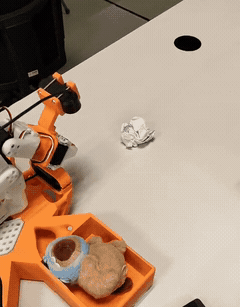
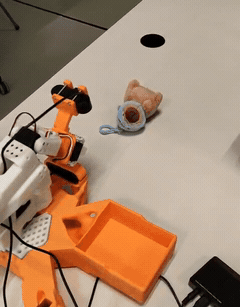
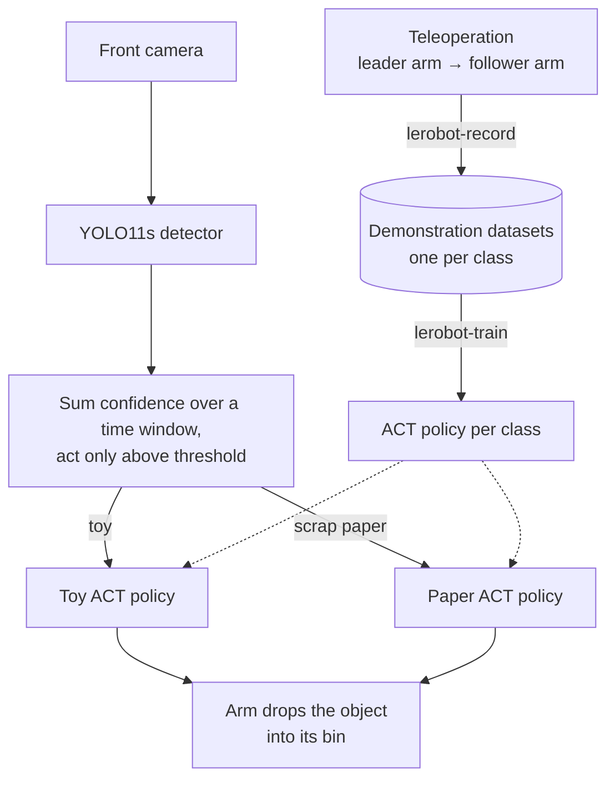

# Handy Robot — sorting household clutter with YOLO and imitation learning

A proof-of-concept robot built on a LeRobot SO-101 arm: a YOLO11s detector recognises a toy or a
piece of scrap paper, and an ACT policy trained for that class picks the object up and drops it
into the matching on-board bin. The whole detect → pick → sort loop runs autonomously. In 102
recorded runs of the final policies it sorted the toy without help in 41% of runs and the
scrap paper in 26% (see [Results](#results)).

<p align="center">
  
  
</p>

TU/e Honors Academy, AI track, 2025–2026. Three-person team, tutor Bram Grooten.

## Hardware

| Part | Details |
|---|---|
| Arm | LeRobot **SO-101** follower arm: 6 DOF with a parallel gripper. Its calibration is in [`configs/calibration/follower_arm.json`](configs/calibration/follower_arm.json). |
| Teleoperation | SO-101 **leader** arm. The operator moves it by hand and the follower copies its joint positions in real time. |
| Cameras | Two USB cameras, both 640×480 at 30 fps for the policies. **Front** is on the base, looks at the floor ahead and also feeds the detector. **Top** is near the gripper and gives a top-down view during the pick. |
| Base | 3D-printed (PLA) mobile base, designed in Siemens NX with topology optimization. It carries the arm, two side-mounted bins and a tricycle wheel layout (two powered rear wheels, one passive ball wheel). Mass went from 4.2 kg to 1.8 kg. The current prototype works from a fixed position; room navigation is out of scope. |
| Robot compute | A laptop with a GTX 1060 Mobile (6 GB VRAM) runs detection and the policies. The arm and cameras connect over a USB hub. |
| Training compute | Final policies: a laptop with an RTX 3070 Mobile (8 GB). Before that, the TU/e HPC cluster (SLURM jobs on an RTX 2080 Ti node) and, at the very start, the GTX 1060 laptop. See [Where we trained](#where-we-trained). |
| Cost | Under €1,000 of hardware, not counting the laptop. |

## Pipeline



1. **Demonstrations.** An operator teleoperates the follower arm with the leader arm. LeRobot
   records joint states together with frames from both cameras.
2. **Training.** One ACT (Action Chunking with Transformers) policy is trained per object class
   with LeRobot. The final policies were trained on an RTX 3070 laptop, earlier ones as SLURM
   jobs on the TU/e HPC cluster.
3. **Detection.** YOLO11s runs on the front camera feed. The script does not react to a single
   frame. It adds up each class's confidence over a time window and compares the total with
   `window seconds × fps × minimum average confidence per frame`.
4. **Dispatch.** The winning class selects its ACT policy, and the arm places the object in the
   matching bin.
5. **Loop.** The system goes back to monitoring. Detection and the policy both need the same
   camera, and a blocked frame read could keep the device open. So detection runs as a separate
   process that reports one class and exits, which frees the camera before the policy starts.

## Data

**ACT demonstrations** (final datasets, recorded on the mobile base):

| | Toy | Scrap paper |
|---|---|---|
| Episodes | 81 | 60 |
| What varies | 1 position, 8 orientations (about 10 episodes each) | 9 positions on a 3×3 grid |
| Frames (30 fps) | 48,484 | 32,472 |

- **Why the datasets differ.** The paper ball looks the same from every side, so only its
  position varies: a 3×3 grid was drawn on a cardboard panel taped in front of the base. The
  toy is asymmetric and the grasp depends on how it is turned, so its orientation varies
  instead.
- **Earlier datasets.** Before the base existed, tabletop datasets were recorded with a tea bag
  box starting inside a 2–3 cm radius. They were used to learn how much data ACT needs.
- **No validation split.** `act_sorttoy` and `act_sortpaper` trained on all episodes
  (`dataset.episodes` is unset in their `train_config.json`). `act_sortpaper_subset40` trained
  on episodes 0–39 of the 60, but the other 20 were never used for a held-out loss. The rollouts
  in Results are the only evaluation.
- **Final datasets and policies on the Hub.** Toy: dataset
  [`MrPsarik/SortToy_20260527_143413`](https://huggingface.co/datasets/MrPsarik/SortToy_20260527_143413),
  policy [`MrPsarik/act_sorttoy`](https://huggingface.co/MrPsarik/act_sorttoy) (50k steps).
  Scrap paper: dataset
  [`MrPsarik/SortPaper_20260529_145930`](https://huggingface.co/datasets/MrPsarik/SortPaper_20260529_145930),
  policy [`MrPsarik/act_sortpaper`](https://huggingface.co/MrPsarik/act_sortpaper) (40k steps,
  all 60 episodes) and
  [`MrPsarik/act_sortpaper_subset40`](https://huggingface.co/MrPsarik/act_sortpaper_subset40)
  (40k steps, episodes 0–39, uploaded on 11 June). In informal trials on the robot the
  40-episode policy worked better than the one trained on all 60, so the integration code
  ([`policy_manager.py`](image_classification/policy_manager.py)) runs `act_sortpaper_subset40`
  for scrap paper. That comparison was not measured, and why fewer episodes did better was
  not investigated.

**YOLO detector dataset:**

- **Collection.** The objects were filmed in different rooms and under different lighting.
  Every 5th frame was extracted and labelled by hand in Label Studio.
- **Size.** About 1,000 images, including augmented copies.
- **Classes.** Toy, scrap paper and recyclable. Recyclable was trained as groundwork for a
  future class and has no arm policy.
- **Split.** 85/15 train/validation, stratified by lighting condition. There is no test set.

## Training

**ACT policies**

| | Toy | Scrap paper |
|---|---|---|
| Training steps | 50,000 | 40,000 |
| Shared settings | chunk size 100, batch size 8, learning rate 1e-5, two cameras (640×480) | same |
| Hardware | laptop, RTX 3070 Mobile | same |

- **Why ACT.** It is LeRobot's recommended policy for GPUs under 8 GB VRAM and for single-task
  grasp-and-place. It was designed for about 50–100 demonstrations, which matches what we could
  record by hand. ACT was not benchmarked against Diffusion Policy or VQ-BeT.


### Where we trained

Training moved between three machines. Every run's settings are in its `train_config.json` on
the Hugging Face Hub, which is where the numbers below come from.

| When | Machine | Policies | Batch | DataLoader workers | AMP |
|---|---|---|---|---|---|
| Dec 2025 | Laptop, GTX 1060 Mobile (6 GB) | `t_policy` (tabletop) | 8 | 4 | no |
| Feb 2026 | TU/e HPC, SLURM, RTX 2080 Ti node | `PaperBalls`, `PaperBallsExt` | 12, 16 | 0 | yes |
| May–Jun 2026 | Laptop, RTX 3070 Mobile (8 GB) | `act_sorttoy`, `act_sortpaper`, `act_sortpaper_subset40` | 8 | 4 | no |

- **GTX 1060 → cluster.** On the GTX 1060, `t_policy` took 0.78 s per step, so 100,000 steps
  ran for 22.4 hours (W&B run `diz5pgoh`).
- **Trying the cluster's GPUs (6–7 Feb 2026).** We submitted the same ACT job (tabletop
  dataset `MrPsarik/t`, two cameras) to whatever GPU partitions were free and logged every
  attempt to W&B: 17 runs, 4 of which reached steady training. The numbers below are the
  median per-step times LeRobot logs, after warm-up:

  | GPU (node) | Batch | Workers | AMP | Update s/step | Data s/step | Samples/s | Outcome |
  |---|---|---|---|---|---|---|---|
  | GTX 1060 Mobile (laptop) | 8 | 4 | no | 0.77 | 0.005 | 10 | 100k steps, 22.4 h |
  | A30 MIG slice, 5.8 GiB (`tue-gpua001`) | 8 | 4 | no | 0.40 | 0.003 | 20 | 3,200 steps, then crashed |
  | A30 MIG slice, 5.8 GiB | 12 | 4 | yes | 0.57 | 0.004 | 21 | 1,200 steps, then crashed |
  | L4 (`tue-gpub001`) | 48 | 4 | yes | 1.31 | 0.02 | 36 | 400 steps, then crashed |
  | V100 16 GB (`mcs-gpua001`) | 32 | 0 | yes | 0.61 | 0.40 | 32 | 200 steps, then crashed |
  | RTX 2080 Ti (`mcs-gpub001`) | 12 | 0 | yes | 0.30 | 0.16 | 26 | `PaperBalls`, 120k steps, 16.5 h |
  | RTX 2080 Ti (`mcs-gpub001`) | 16 | 0 | yes | 0.38 | 0.20 | 28 | `PaperBallsExt`, 100k steps, 16.0 h |

  The L4 and V100 rows rest on one or two logged points, so treat them as rough. Ten more
  attempts failed within seconds; W&B kept their console output, so the causes are known:

  | Attempt | Error |
  |---|---|
  | A30, batch 16 and 64 | CUDA out of memory: "GPU 0 has a total capacity of 5.81 GiB", with another user's process holding 1.79 GiB of it. The A30 (24 GB) is split with MIG, and a job gets one slice. |
  | V100, batch 48 and 64; L4, batch 64 | CUDA out of memory at 15.8 GiB and 22 GiB |
  | V100, 4 and 2 workers | "DataLoader worker … killed by signal: Bus error … out of shared memory" |
  | V100, `PaperBallsExt`, 4 workers | "unable to write to file </torch_…>: No space left on device" (shared memory again) |
  | Two A30s with `accelerate` | NCCL "Duplicate GPU detected: rank 0 and rank 1 both on CUDA device …": both processes landed on the same GPU, so multi-GPU training never started |
- **What the numbers say.** Moving from the GTX 1060 to any cluster GPU doubled to tripled the
  throughput, not more: these are short ACT runs on a small model, where GPU generation
  matters less than it does on paper. With `num_workers=0` (2080 Ti, V100), loading data took
  0.16–0.40 s of every step, a third or more of the step time, against about 0.005 s with
  four workers. That was the price of the DataLoader fix below.
- **Getting jobs to run on the cluster.** A batch job starts in a non-interactive shell, so the
  conda environment was not active and `lerobot-train` was not found. The job script now
  sources `~/.bashrc` and activates the environment itself. Before each full run, a short
  interactive job checked the environment first, so a path mistake would not cost a long queue
  wait.
- **Slow first runs.** The first jobs trained, but slowly: `nvidia-smi` showed GPU utilisation
  jumping up and then dropping to idle, which pointed at the GPU waiting for data rather than at
  the GPU itself.
- **Speeding up crashed the DataLoader.** A larger batch with mixed precision (AMP) and more
  DataLoader workers crashed with `DataLoader worker … is killed by signal: Bus error. It is
  possible that dataloader's workers are out of shared memory`. Lowering the workers to 2 still
  crashed, and the job had 64 GB of RAM, so ordinary memory was not the issue. PyTorch workers
  pass decoded video frames to the main process through shared memory (`/dev/shm`), and the
  nodes have little of it. (LeRobot also
  does not take `--gradient_accumulation_steps` as a command-line flag, so that route was out.)
- **Fix.** `--num_workers=0` loads data in the main process, so no shared memory is needed.
  With AMP and a batch of 12–16 this trained the February policies without crashes. The cost
  is that data loading is no longer parallel.
- **Cluster → RTX 3070 laptop.** For the final policies a laptop with an RTX 3070 Mobile turned
  out to be faster in practice than the cluster, with no queue either, so we trained there with
  LeRobot's defaults (4 workers, no AMP). `act_sortpaper` (40,000 steps from scratch) started at
  18:45 and was on the Hub at 20:10, so about 1.5 hours, roughly 8 steps/s (W&B was off for the final runs, so this comes from
  the shell history and the Hub upload time, not from a training log). `act_sorttoy` was
  first trained for 20,000 steps and later resumed to 50,000. We did not profile why the laptop
  beat the cluster. Likely factors are the newer GPU generation and that data loading could run
  in parallel workers again.
- **Running the policies on the robot laptop (GTX 1060).** The first rollouts ran the control
  loop at about 3.5 Hz instead of 30 Hz: inference had silently fallen back to the CPU. The
  installed PyTorch wheels (cu128) ship no kernels for the GTX 1060's architecture (sm_61,
  Pascal), and the driver only supported CUDA 12.2. Installing PyTorch from the cu126 index
  fixed it; `torch.cuda.get_arch_list()` confirms that `sm_61` is included. Around the same
  time LeRobot dropped `--policy.path` from `lerobot-record`, so the policies are run with
  `lerobot-rollout` instead (see [Run a trained policy](#run-a-trained-policy)).

**YOLO11s detector**

- **Setup.** Fine-tuned from pretrained `yolo11s.pt` with default Ultralytics augmentations. Up
  to 120 epochs with early stopping (patience 30), input size 896, batch size 4.
- **Run.** From the metadata in [`image_classification/best.pt`](image_classification/best.pt):
  training stopped after 70 epochs, and the logged training time was about 29 minutes.
<!-- TODO: on which machine was YOLO trained? -->

## Results

**End-to-end sorting (final design, June 2026).** Measured afterwards from the recordings: every
run of the final per-class ACT policies that was saved to the Hugging Face Hub was watched and
labelled by hand in October 2026. The labelling page, the labels and the script that builds the
tables below are in [`eval/`](eval/) (`python eval/summarize.py`).

There was no test protocol. These are all recorded runs from two sessions: S1 in the lab on
10 June and S2 at the Demo Day stand on 12 June. Start positions and orientations were not
controlled or written down. Each run lasts 20 s. A run counts as a success when the object ends
up in the correct bin within those 20 s without help. Runs where a person helped by hand count
as failures.

| Class | Session | Runs | Success | Helped by hand | Failure | Success rate |
|---|---|---|---|---|---|---|
| Toy | S1, lab, 10 Jun | 4 | 3 | 0 | 1 | 3/4 |
| Toy | S2, Demo Day stand, 12 Jun | 52 | 20 | 1 | 31 | 38% |
| **Toy** | **both** | **56** | **23** | **1** | **32** | **41%** |
| Scrap paper | S1, lab, 10 Jun | 8 | 1 | 3 | 4 | 1/8 |
| Scrap paper | S2, Demo Day stand, 12 Jun | 38 | 11 | 1 | 26 | 29% |
| **Scrap paper** | **both** | **46** | **12** | **4** | **30** | **26%** |

| Failure reason | Toy | Scrap paper |
|---|---|---|
| Missed grasp | 27 | 17 |
| Shaking / collision | 3 | 5 |
| Wrong bin | 0 | 4 |
| No attempt | 0 | 1 |
| Other | 2 | 2 |
| No reason given | 0 | 1 |

- **Missed grasps dominate**, which matches the missing recovery behaviour described under
  limitations. In 8 failures the arm did hold the object but it never reached the bin, and in at
  least 5 of those the 20 s ran out.
- **Left out (17 of 119 recordings):** 6 recordings with a single frame, 9 runs with no object in
  reach (an empty table, or a visitor put the object down outside the arm's reach), 1 recording
  cut short, and 1 run where the toy policy was started while scrap paper lay on the table. That
  last one is a pipeline error, not a policy error.
- **Background.** For the first part of S2 the scene camera looked into the exhibition hall,
  with people moving behind the object. At about 15:25 we put a cardboard partition behind
  the workspace. Before it 6 of 27 runs succeeded (22%), after it 25 of 63 (40%), in the same
  direction for both classes. This fits the demonstrations being recorded against a plain
  background, but it is not proof: the sample is small (Fisher's exact test p = 0.15), and
  the surface under the object also changed during the first half of the day.
- **Caveats.** The sample is small and uncontrolled, and S1 is too small to compare with S2. The
  recordings do not store which policy ran. For scrap paper, `act_sortpaper_subset40` was
  uploaded on 11 June, between S1 and S2, and is the one the integration code runs, so S2 most
  likely used it and S1 used `act_sortpaper`. The `eval_*` datasets on the Hub come from
  earlier iterations and mix policy runs with teleoperated recordings under the same name, with
  nothing in the data to tell them apart, so they are not part of this evaluation.

**YOLO11s detector, validation set**

| Metric | `best.pt` (epoch 40) | Last epoch (70) |
|---|---|---|
| Precision | 0.981 | 0.986 |
| Recall | 0.983 | 0.989 |
| mAP@50 | 0.986 | 0.990 |
| mAP@50–95 | 0.782 | 0.779 |

- **Source.** Both columns come from the training log stored in `best.pt`. The report quotes
  the last-epoch values rounded (0.99 / 0.99 / 0.99 / 0.78). `best.pt` is the checkpoint used
  on the robot.
- **Caveat.** Validation frames come from the same videos as the training frames, and each
  class has very few physical objects. These numbers describe these objects in these rooms,
  not unseen household items.

## What didn't work / limitations

- **Recovery after a missed grasp.** This is the main failure mode. The demonstrations contain
  almost only successful picks, so the policy has no example of what to do after a miss.
- **Rear-mounted bins (base design 1).** To reach bins at the rear, the arm swung each object
  over the chassis. After a missed grasp the policy snapped back to its start pose, which shook
  the tall, narrow base. The same happened when two objects were in view. Lowering the control
  frequency only softened the symptom. Moving the bins to the sides (design 2) and retraining
  the policies stopped the shaking.
- **Temporal ensembling.** We tried ACT's temporal ensembling to smooth motion. On the laptop's
  GTX 1060, querying the policy every step lowered the control frequency, and the averaging
  lagged behind the arm so the gripper stopped short of the object. We went back to plain
  chunked execution.
- **Generalization.** Each policy was trained on essentially one physical object and only works
  for the positions and orientations it was shown. It degrades elsewhere and on other surfaces.
  On the tabletop, success dropped quickly outside the 2–3 cm starting radius.
- **Shape over colour.** The tabletop policy was trained on a tea bag box. It closed the gripper
  at the wrong height on a yellow piece of cheese, and it still tried to pick up a box it had
  never seen. Placement was much less precise than picking.
- **Detector data leakage.** Near-identical neighbouring frames can end up in both train and
  validation, which likely inflates the metrics. A split by time within each video would fix
  this. The model was not retrained.
- **One class-conditioned ACT.** Feeding the class label into a single ACT policy would have
  meant changes across LeRobot's dataset, recording, training and inference code. We kept one
  policy per class, and the two approaches were never compared.
- **No evaluation protocol from the start.** No success rate was recorded during the project.
  The numbers in Results were labelled afterwards from the saved runs, so start positions are
  unknown and the two sessions are not comparable trials.
- **Setup and scope.** LeRobot would not install under WSL (the `evdev` build fails), so we used
  native Ubuntu. The prototype works from a fixed position; navigation, on-board compute and
  docking are future work.

## Team & my role

**My role:** project management / Scrum master; recording the demonstration datasets;
running the training, first as SLURM jobs on the TU/e cluster and later on a local GPU; the policy dispatch and execution loop that runs
the selected ACT policy after detection, built together with Rovshan Ayyubov.

**Teammates' contributions:**

- **Rovshan Ayyubov** — object classification: YOLO dataset collection and preparation,
  labelling, training and evaluation. Also the confidence-aggregation trigger and, together
  with me, the detection-to-policy integration.
- **Francisco Fernández Gutiérrez** — mechanical design: the mobile base in Siemens NX, the
  MATLAB stability analysis and the topology optimization. Also helped label the YOLO dataset
  and record demonstrations.

## How to reproduce

These are the LeRobot commands the team used. The ports, dataset names and task strings are
examples, so replace them with your own.

<details>
<summary>Set-up, calibration, teleoperation, recording, training, running a policy</summary>

### Set-up
```bash
conda activate lerobot
cd lerobot
sudo chmod 666 /dev/ttyACM*
lerobot-find-port
lerobot-find-cameras opencv
```

When only one arm is connected it can show up on either port. If a command fails because of
the port, switch between `ACM0` and `ACM1`.

### Calibrate
```bash
lerobot-calibrate \
    --robot.type=so101_follower \
    --robot.port=/dev/ttyACM0 \
    --robot.id=follower_arm

lerobot-calibrate \
    --teleop.type=so101_leader \
    --teleop.port=/dev/ttyACM1 \
    --teleop.id=leader_arm
```

### Teleoperate
```bash
lerobot-teleoperate \
    --robot.type=so101_follower \
    --robot.port=/dev/ttyACM0 \
    --robot.id=follower_arm \
    --robot.cameras="{ front: {type: opencv, index_or_path: 0, width: 640, height: 480, fps: 30}, top: {type: opencv, index_or_path: 2, width: 640, height: 480, fps: 30}}" \
    --teleop.type=so101_leader \
    --teleop.port=/dev/ttyACM1 \
    --teleop.id=leader_arm \
    --display_data=true
```

### Record demonstrations
```bash
lerobot-record \
    --robot.type=so101_follower \
    --robot.port=/dev/ttyACM1 \
    --robot.id=follower_arm \
    --robot.cameras="{front: {type: opencv, index_or_path: 0, width: 640, height: 480, fps: 30}, top: {type: opencv, index_or_path: 2, width: 640, height: 480, fps: 30}}" \
    --teleop.type=so101_leader \
    --teleop.port=/dev/ttyACM0 \
    --teleop.id=leader_arm \
    --display_data=true \
    --dataset.repo_id="MrPsarik/PaperBalls" \
    --dataset.num_episodes=5 \
    --dataset.single_task="Put a paper ball into the robot container" \
    --dataset.reset_time_s=30
```
Add `--resume=true` to keep recording into an existing dataset.

### Replay one episode
```bash
lerobot-replay \
    --robot.type=so101_follower \
    --robot.port=/dev/ttyACM1 \
    --robot.id=follower_arm \
    --dataset.repo_id=MrPsarik/t \
    --dataset.episode=0
```

### Train an ACT policy
The command used for the final toy policy (RTX 3070 laptop):
```bash
lerobot-train \
    --dataset.repo_id=MrPsarik/SortToy_20260527_143413 \
    --policy.type=act \
    --policy.device=cuda \
    --policy.repo_id=MrPsarik/act_sorttoy \
    --output_dir=outputs/train/act_sorttoy \
    --job_name=act_sorttoy \
    --batch_size=8 \
    --steps=20000 \
    --save_freq=5000 \
    --wandb.enable=false

# resume from the last checkpoint and continue to 50,000 steps
lerobot-train \
    --resume=true \
    --steps=50000 \
    --config_path=outputs/train/act_sorttoy/checkpoints/last/pretrained_model/train_config.json
```
The scrap-paper policy is the same with `SortPaper_20260529_145930`, `act_sortpaper` and
`--steps=40000` in one run. For the cluster, see [`slurm/train_act.slurm`](slurm/train_act.slurm).

### Run a trained policy
With LeRobot 0.5.x (used for the final policies):
```bash
lerobot-rollout --strategy.type=sentry \
    --policy.path=MrPsarik/act_sorttoy \
    --policy.device=cuda \
    --robot.type=so101_follower \
    --robot.port=/dev/ttyACM0 \
    --robot.id=follower_arm \
    --robot.cameras="{front: {type: opencv, index_or_path: 0, width: 640, height: 480, fps: 30}, top: {type: opencv, index_or_path: 2, width: 640, height: 480, fps: 30}}" \
    --dataset.repo_id=MrPsarik/rollout_SortToy_20260527_143413 \
    --dataset.single_task="Put toy into the right bin"
```
On a GTX 10xx GPU install PyTorch from the cu126 index first
(`pip install --index-url https://download.pytorch.org/whl/cu126 torch torchvision`), or
inference falls back to the CPU.

Older LeRobot versions (used for the tabletop policies) ran a policy through `lerobot-record`:
```bash
rm -rf ~/.cache/huggingface/lerobot/MrPsarik/eval_t   # clear the eval cache before each run

lerobot-record \
    --robot.type=so101_follower \
    --robot.port=/dev/ttyACM0 \
    --robot.cameras="{front: {type: opencv, index_or_path: 0, width: 640, height: 480, fps: 30}, top: {type: opencv, index_or_path: 2, width: 640, height: 480, fps: 30}}" \
    --robot.id=follower_arm \
    --display_data=false \
    --dataset.repo_id=MrPsarik/eval_t \
    --dataset.single_task="Move yellow block" \
    --policy.path=MrPsarik/t_policy
```

### Detector only
```bash
cd image_classification
python live_detect.py --model best.pt --camera 0   # press q to quit
```

### Full detect → pick → sort loop
```bash
cd image_classification
python fake_robot.py
```
Each cycle starts `detect_once.py` as a separate process, waits for one confident class, and
then `policy_manager.py` runs the matching `lerobot-rollout` (toy → `act_sorttoy`, scrap paper
→ `act_sortpaper_subset40`). The robot port and camera indices are set at the top of
`policy_manager.py`.

</details>

**Not reproducible from this repo yet:**

- **SLURM job script.** The original was lost; [`slurm/train_act.slurm`](slurm/train_act.slurm)
  is a reconstruction (see [Where we trained](#where-we-trained)).

## License

Apache 2.0 — see [LICENSE](LICENSE).
